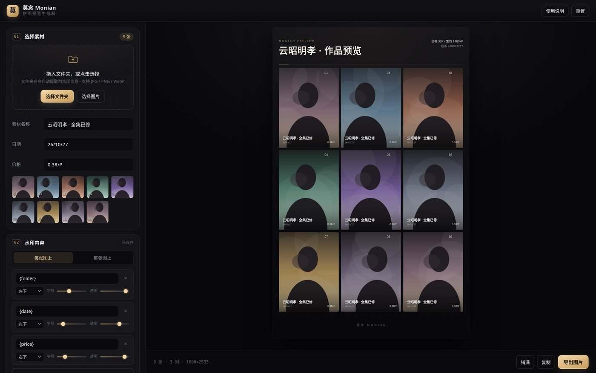
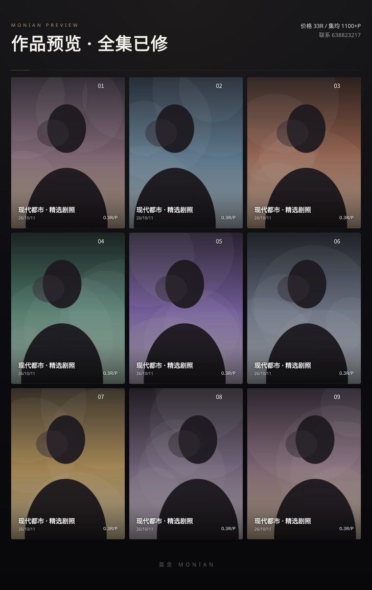
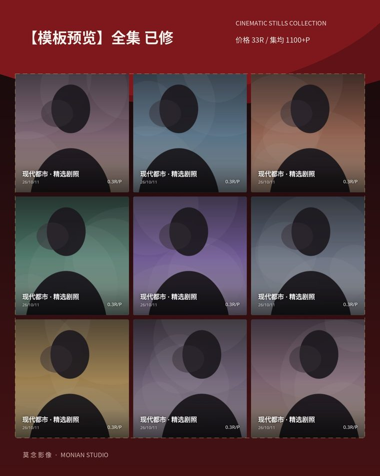
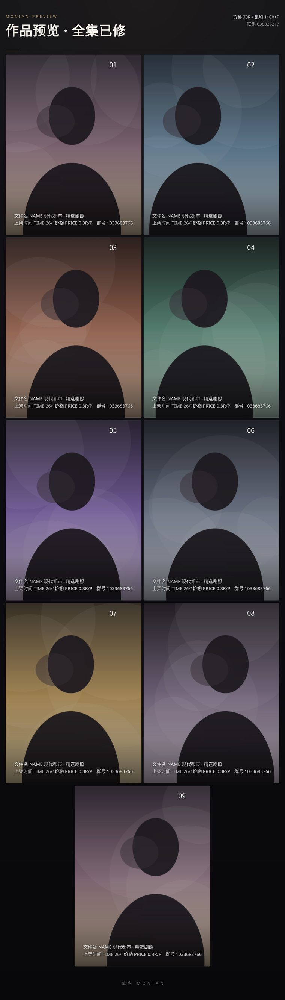

# 莫念 Monian · 拼图预览生成器

> 上传一个文件夹，自动拼成一张带水印的高清预览长图。纯前端、无需服务器、照片不会离开你的设备。



## 这是什么

做素材展示时，常常要把一组剧照、写真拼成一张"预览长图"，再在每张图上打上作品名、上架时间、价格、群号等信息。手动用 PS 一张张排，慢且容易出错。

这个工具把这件事变成两步：

1. 把文件夹拖进来
2. 点导出

程序会自动读出文件夹名和文件时间，套用你保存好的水印格式，排好版，生成一张可以直接发出去的预览图。

## 功能

| 功能 | 说明 |
| --- | --- |
| **文件夹批量导入** | 选中文件夹即可，按文件名自然排序；也支持直接拖拽、多选图片 |
| **自动提取信息** | 文件夹名 → 素材名称；文件修改时间 → 日期；自动带入水印 |
| **水印一次输入，长期复用** | 所有水印文字保存在本机浏览器，下次打开自动带出；改文字即可，或一键清空重输 |
| **占位符** | `{folder}` `{date}` `{price}` `{index}` `{count}` 自动替换 |
| **每张图独立水印** | 九宫格定位、独立字号、独立透明度，可加任意多条 |
| **整张图水印** | 用于在整图角落加品牌、群号等 |
| **背景模板** | 上传设计好的背景图（含标题栏、底栏），用四个滑块把照片框进空白区域 |
| **四种版式** | 上下拼接 / 两列 / 三列 / 四列，列数可 1–6，间距、留白、圆角可调 |
| **高清导出** | 1080 / 1600 / 2000 / 2400 / 3000 px 宽，JPG / PNG，画质可调 |
| **全端可用** | 电脑、安卓、iPhone、iPad 自适应，可"添加到主屏幕"当 App 用 |
| **隐私** | 所有运算在浏览器内完成，图片不上传任何服务器 |

### 效果示例

| 三列网格（无模板） | 套用背景模板 | 两列排版 |
| :---: | :---: | :---: |
| [](docs/preview-3col.jpg) | [](docs/preview-template.jpg) | [](docs/preview-2col.jpg) |

## 使用方法

1. **选择素材** — 点「选择文件夹」。程序会读取文件夹名作为素材名称，并取文件的最新时间作为日期。
   - 手机浏览器不支持选文件夹时，用「选择图片」多选，再手动填写素材名称。
2. **写水印** — 默认已有三条（名称 / 日期 / 价格）。想加就在「每张图上」里点「＋ 添加一条水印」，选位置、调字号和透明度。
   - 文字输入后自动保存，**下次打开还在**。要换内容直接改，或点「清空当前页」重新输入。
3. **可选：套模板** — 上传一张背景模板，调「图片放置区域」的上/右/下/左四个百分比，让照片正好嵌进模板的空白处。勾选「显示参考线」可以看到框选范围（不会被导出）。
4. **调版式** — 点「上下拼接 / 两列 / 三列 / 四列」，或拖列数滑块，右侧实时预览。
5. **导出** — 选宽度和格式，点「导出图片」。也可以点「复制」直接粘贴到聊天窗口。

### 水印排版建议

- 字号保持在格子宽度的 3%–5%，配合 `左下` 位置和较低透明度，既看得清又不会挡住人物。
- 想要文字在浅色画面上也清楚，程序会自动在图片底部加一层很淡的黑色渐变衬底。
- 位置排不下时，同一侧的多条水印会自动缩小字号，避免溢出。

## 部署到 GitHub Pages（免费、可长期使用）

### 方式一：网页上传（不用命令行）

1. 在 GitHub 新建一个仓库，例如 `monian-preview`，设为 **Public**。
2. 进入仓库，点 **Add file → Upload files**，把本项目里的这些**文件和文件夹**整体拖进去：
   ```
   index.html
   manifest.json
   .nojekyll
   assets/
   ```
3. 提交后进入 **Settings → Pages**，Source 选 `Deploy from a branch`，Branch 选 `main` / `root`，保存。
4. 等 1 分钟左右，访问 `https://你的用户名.github.io/monian-preview/` 即可。

### 方式二：命令行

```bash
git clone https://github.com/你的用户名/monian-preview.git
cd monian-preview
# 把本项目文件复制进来
git add .
git commit -m "feat: 莫念拼图预览生成器"
git push
```

然后在仓库 **Settings → Pages** 里开启 Pages。

### 以后更新

改完文件后 `git add . && git commit -m "更新" && git push`，Pages 会在 1 分钟内自动重新发布。如果是网页上传的方式，直接在 GitHub 里替换对应文件即可。

## 本地打开

```bash
# 任选一种起一个本地静态服务
python3 -m http.server 8000
# 或
npx serve
```

然后访问 `http://localhost:8000`。

> 直接双击 `index.html` 也能用，但部分浏览器对本地文件的 IndexedDB / 剪贴板有限制，建议用上面的方式。

## 项目结构

```
.
├── index.html              页面结构
├── manifest.json           PWA 配置（可添加到主屏幕）
├── .nojekyll               让 GitHub Pages 保留以下划线开头的文件
├── assets/
│   ├── css/style.css       全部样式（含移动端适配）
│   ├── js/core.js          工具函数、状态、localStorage / IndexedDB 持久化
│   ├── js/render.js        画布排版与绘制（预览与导出共用同一套逻辑）
│   ├── js/app.js           界面交互、文件处理、导出
│   └── img/                图标
└── docs/                   截图
```

## 技术说明

- **零依赖**：原生 HTML / CSS / JavaScript，不用构建，改完刷新就生效。
- **单一渲染管线**：预览和导出调用同一个 `MN.Render.paint()`，只是传入的宽度不同，所以预览看到什么，导出就是什么。
- **高质量缩放**：缩小图片时按 2 倍逐级降采样，避免直接 `drawImage` 造成的锯齿和糊。
- **内存控制**：导入时把图片长边限制在 2600px，既保证 3000px 输出够用，也避免一次导入几十张原图把手机内存打爆。
- **持久化**：文字类设置存 `localStorage`；模板原图存 `IndexedDB`（避免超出 localStorage 容量）。

## 常见问题

**Q：为什么导出的图上文字有点小？**
调「字号」滑块，或减小列数。列数越多，单格越小，同样倍数的字号就越小。

**Q：HEIC 格式的图导入失败？**
浏览器无法解码 HEIC。先在手机里把照片导出为 JPG（iOS：设置 → 相机 → 格式 → 兼容性最佳），或截图后再用。

**Q：导出提示"尺寸过大"？**
长图有像素上限（单边 16384px）。降低输出宽度，或减少图片张数 / 增加列数。

**Q：换电脑或换浏览器后水印没了？**
设置保存在**本机浏览器**里，换设备不会同步。重新输入一次即可。

**Q：模板调不准位置？**
勾选「显示放置区域参考线」，四个滑块分别对应上、右、下、左的百分比，配合预览慢慢调。

## License

[MIT](LICENSE) © 莫念 Monian
